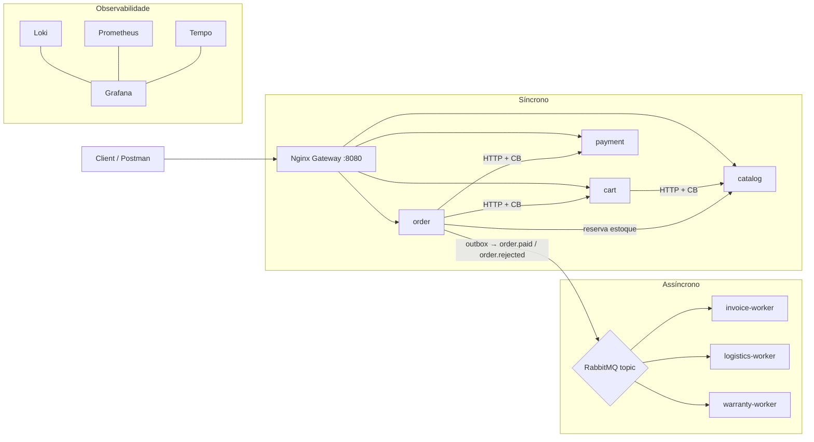

# 🛒 Lab de Microsserviços — E-commerce

Laboratório de **Arquitetura de Microsserviços** com um e-commerce de ponta a ponta que demonstra, na prática, como sistemas distribuídos funcionam no mercado atual: comunicação síncrona e assíncrona, **API Gateway**, **Database-per-Service**, **Outbox**, **Saga/compensação**, **Circuit Breaker**, **idempotência** e **observabilidade** (logs, métricas e tracing).

## Conceitos cobertos

- **Microservicos**: catalog, cart, order, payment, invoice, logistics, warranty, messaging-demo. Alta coesão e baixo acoplamento.
- **API Gateway** (Nginx): roteamento `/api/v1/*`, rate limit, `X-Correlation-ID`
- **Database-per-Service**: 7 databases num PostgreSQL
- **Comunicação síncrona** (HTTP) vs **assíncrona** (eventos no RabbitMQ topic)
- **Circuit Breaker + timeout** entre serviços (`lab_common.http_client`)
- **Outbox Pattern**: publicação de eventos transacional (at-least-once)
- **Saga / compensação**: reserva de estoque + `order.rejected` cancelando logística/garantia
- **Idempotência durável** (constraints UNIQUE + upsert)
- **Validação de contrato** (marshmallow/apiflask) e **versionamento** de API
- **Observabilidade**: logs (Loki), métricas (Prometheus), tracing distribuído (Tempo) com **correlation ID** e **W3C Trace Context** de ponta a ponta
- **Docker**: imagens, rede, volumes, dependências.
- **Docker Compose**: configuração, dependências, rede.
- **PostgreSQL**: criação de schemas, constraints UNIQUE + upsert
- **RabbitMQ**: topic, work queue, DLQ
- **Grafana**: dashboards, métricas, logs, traces
- **Prometheus**: métricas, rate limit, circuit breaker

## Arquitetura



## Serviços

| Serviço | Tipo | Responsabilidade | Banco |
|---|---|---|---|
| **catalog** | API Flask | CRUD de produtos + reserva/liberação de estoque | `catalog_db` |
| **cart** | API Flask | Carrinho; valida preço/catálogo via HTTP | `cart_db` |
| **order** | API Flask | Checkout, saga, **Outbox** + publicação de eventos | `order_db` |
| **payment** | API Flask | Pagamento simulado (falha/latência configuráveis) | `payment_db` |
| **invoice** (`invoice-worker`) | Worker | Emissão de NF (assíncrona) | `invoice_db` |
| **logistics** (`logistics-worker`) | Worker | Agenda entrega; compensa `order.rejected` | `logistics_db` |
| **warranty** (`warranty-worker`) | Worker | Garantia estendida (itens elegíveis) | `warranty_db` |
| **messaging-demo** | API + workers | *Exemplo legado*: Pub/Sub vs Work Queue | `messages_db` |

Infraestrutura: **Nginx** (gateway), **PostgreSQL**, **RabbitMQ**, **Loki + Promtail**, **Prometheus**, **Grafana Tempo**, **Grafana**, **cAdvisor**.

## Como executar

```sh
git clone https://github.com/josemanzoli/lab-microservicos
cd lab-microservicos

cp .env.example .env          # ajuste senhas se quiser
docker compose up -d --build
```

> Primeira subida leva ~1–2 min (build das imagens + criação dos databases). O catálogo é **seedado automaticamente** com 5 produtos.

### Reset completo (voltar ao zero)

```sh
docker compose down -v        # remove databases e filas
docker compose up -d --build
```

Se só quiser recriar os databases sem apagar o volume: `./scripts/reset_db.sh`.

## Acessos

| Interface | URL |
|---|---|
| **API Gateway** | http://localhost:8080 |
| **ReDoc** (documentação combinada) | http://localhost:8080/docs (ou `/redoc`) |
| **Swagger UI** (com Try it out) | http://localhost:8080/docs/swagger.html |
| **Grafana** | http://localhost:3000 (`admin` / senha do `.env`) |
| **Prometheus** | http://localhost:9090 |
| **Tempo** | http://localhost:3200 |
| **RabbitMQ Management** | http://localhost:15672 (`admin` / senha do `.env`) |

> Dashboards no Grafana: **"E-commerce Microservices"** (serviços novos) e **"Microservices Observability"** (exemplo legado).

## API pública (via gateway, versionada)

| Método | Path | Descrição |
|---|---|---|
| GET | `/api/v1/catalogo/products` | Lista produtos |
| POST | `/api/v1/catalogo/products` | Cria produto |
| POST | `/api/v1/carrinho/carts/:id/items` | Adiciona item ao carrinho |
| GET | `/api/v1/carrinho/carts/:id` | Consulta carrinho |
| POST | `/api/v1/pedidos/orders` | Cria pedido (checkout + pagamento) |
| GET | `/api/v1/pedidos/orders/:id` | Consulta pedido |
| POST | `/api/v1/pagamentos/payments` | Processa pagamento (simulado) |
| GET | `/api/v1/pedidos/metrics` | Métricas Prometheus do order |

> Documentação combinada de **todos os serviços** em ReDoc (`/docs`) ou Swagger UI com Try it out (`/docs/swagger.html`). Internamente, cada serviço também expõe seu próprio OpenAPI (`/docs`, `/openapi.json`), mas o acesso externo é pelo gateway.

## Demos (scripts prontos)

```sh
./scripts/demo_flow.sh      # happy path: catálogo → carrinho → pedido → NF/logística/garantia
./scripts/demo_chaos.sh     # derruba o payment → Circuit Breaker abre → pedido rejeita rápido
./scripts/load_orders.sh 50 # carga de 50 pedidos (observa métricas/DLQ)
./scripts/smoke_test.sh     # valida endpoints em poucos segundos
```

## Estrutura

```
lab-microservicos/
├── shared/lab_common/        # biblioteca: logger, tracing, rabbitmq, worker, http_client, db, health, correlation
├── services/                 # 8 serviços (apis + workers)
│   ├── messaging-demo/       # exemplo legado (Pub/Sub vs Work Queue)
│   ├── catalog/ cart/ order/ payment/
│   └── invoice/ logistics/ warranty/
├── config/                   # nginx, prometheus, grafana, loki, tempo, postgres
├── scripts/                  # demos + reset + seed
├── docs/                     # ReDoc + Swagger UI (OpenAPI combinado) + Postman + roteiro de aula
└── docker-compose.yml        # âncoras YAML + env vars (12-factor)
```

## Configuração por ambiente

As variáveis de simulação ficam no `.env` (12-factor):

| Variável | Default | Efeito |
|---|---|---|
| `PAYMENT_FAILURE_RATE` | `0.2` | Probabilidade do pagamento ser recusado |
| `PAYMENT_LATENCY_MS` | `0` | Latência artificial do pagamento (ms) |
| `HTTP_CALL_LATENCY_MS` | `20` | Latência de rede simulada entre serviços (por chamada HTTP) |
| `SERVICE_PROCESSING_LATENCY_MS` | `10` | Latência de processamento simulada por requisição |
| `INVOICE_FAIL_RATE` | `0.0` | Probabilidade de falha do invoice (→ DLQ) |

## CI

GitHub Actions (`.github/workflows/ci.yml`): lint (sintaxe Python + `docker compose config`), build das imagens e **smoke test end-to-end**.

## ⚠️ Limitações conhecidas

- **cAdvisor** não expõe métricas corretamente no macOS (usa paths Linux). Desative com `docker-compose.override.yml` se desejar (o resto da stack funciona normalmente).

## License

[MIT](LICENSE)